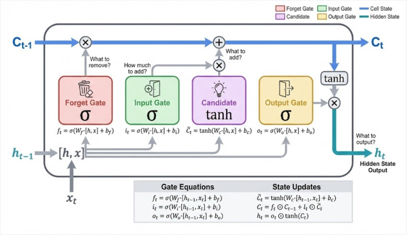

# LSTM Training
Bla bla bla

## Some Notes
A lot of this stuff is confusing at the moment, so I am going to do research on LSTMs, and try to understand what is going on. To begin, LSTM stands for "Long Short-Term Memory", and is very good for time-series data. It is very good at taking previous time data, and then using that to predict the future. 

An LSTM maintains two separate vectors that it uses to predict the future:
1. The **cell state**. This acts as long-term storage, containing information across time steps with modifications occurring at each step. Basically, this is our memory.
2. The **hidden state**. This is the cell's output at each timestep. We use this to feed into the next timestep, and is the prediction for the given timestep. 

An LSTM has **3 inputs** and **2 outputs**:

**Inputs**:
- Previous cell state ($C_{t-1}$), which is what the network has remembered so far
- Previous hidden state ($h_{t-1}$), which is the last timestep's output
- Current input ($x_t$), which is the new token.

**Outputs**:
- Updated cell state ($C_t$), which is the updated memory
- New hidden state ($h_t$), which is the current timestep's output

Within the model "cell", four gates control what happen. They output values between 0-1, and act as filters, except for the last one, which proposes new content:
1. Forget gate ($f_t$): checks if some part of context should be forgotten
2. Input gate ($i_t$): how much should $x_t$ contribute to context? Will scale the contribution of the Candidate.
3. Candidate ($C̃_t$): what new info does $x_t$ add? Candidate proposes content.
4. Output gate ($o_t$): what should the hidden state output? Filters cell state to produce $h_t$.

Each component computes its output the same way. In general, this is how we calculate output $f$ for some component $c$:
1. Concatenate $x_t$ and $h_{t-1}$ into a single vector ($[h_{t-1},x_t]$)
2. Multiply the vector by a specialized weight matrix ($W_c$)
3. Add some specialized bias ($b_c$)
4. Finally, we apply an activation function, either sigmoid or tanh ($\psi$)

The final general formula for some component is:
$$f_c=\psi(W_c \cdot [h_{t-1},x_t] + b_c)$$

$f_t, i_t$, and $o_t$ use the sigmoid activation function $\sigma$, which squishes output values into a range between 0 and 1. $C̃_t$ uses the tanh activation function, which squishes values between -1 and 1.

<small>*A graph representation of the cell model courtesy https://www.datacamp.com/tutorial/lstm-models*</small>

Note that the forget gate multiplies against the cell state $C_{t-1}$. The output multiplies $C_{t-1}$ position-by-position. For example, take the cell state and output vectors:

$$f_t=\begin{bmatrix} 1 \\ 0.2 \\ 0 \end{bmatrix} C_{t-1}=\begin{bmatrix} 4 \\ 10 \\ 5 \end{bmatrix}$$

These get multiplied and we get:
$$\begin{bmatrix} 1 \\ 0.2 \\ 0 \end{bmatrix} \odot \begin{bmatrix} 4 \\ 10 \\ 5 \end{bmatrix} = \begin{bmatrix} 4 \\ 2 \\ 0 \end{bmatrix}$$

A few interesting things happen here:
1. Notice that with an output value of 1, the corresponding cell state value is completely preserved.
2. With a value of 0, the corresponding cell state value is entirely erased.
3. With an output value between 0 and 1 (not inclusive), the corresponding cell state value is scaled down to a certain extent. A smaller number implies that the corresponding value should be forgotten "more", while a larger number is preserved more.

With all this information, we can derive a formula for getting $C_t$ and $h_t:$
1. The forget gate (or filter) is applied: $$f_t \odot C_{t-1}$$ Our cell state has been updated for the current timestep.
2. The candidate proposes an addition, and the input gate scales that proposal: $$C̃_t \odot i_t$$
3. We add the candidate's scaled proposal to our updated cell state, giving us our new cell state: $$C_t=(f_t \odot C_{t-1}) + (C̃_t \odot i_t)$$
4. The output gate's value $o_t$ is multiplied by the new cell state which was passed through a tanh activation function in order to keep the output bounded. This gives us our hidden state: $$h_t = o_t \odot tanh(C_t)$$

So, finally, we get:
$$C_t=(f_t \odot C_{t-1}) + (C̃_t \odot i_t)$$
$$h_t = o_t \odot tanh(C_t)$$

At any point, we can then use the hidden step $h_t$ to predict the next value.

## The Sliding Window
This also confused me for a while so let's walk through it briefly.

We want to be able to train the model to predict some future gas concentration given some history of concentrations. For instance, we give the model the last 24 hours of data, and the model will attempt to predict the next hour's concentration. In order to do this, we need
1. A split of training and testing data. Usually, an 80:20 split works well
2. Blocks of 24 hour windows, and the next hour's concentration

Let's tackle 2. first. In order to train our model, we need input X and output y. We give the model X and then compare its answer with our true value y. 

Imagine an array: $$d=[1,2,3,4,5,6,7]$$
Now, given some window size (in our case we will choose that to be 3), this is what each X and y would look like:

$$X_1 = [1,2,3], y_1=4$$
$$X_2 = [2,3,4], y_2=5$$
$$X_3 = [3,4,5], y_3=6$$
$$X_4 = [4,5,6], y_4=7$$

This is now a very nice format for us to split the data! We can't exactly get an 80:20 split here, but a 90:10 will do. Our training set will look like: $$T=\{(X_1,y_1),(X_2,y_2),(X_3,y_3)\}$$
and our test set: $$t=\{X_4,y_4\}$$

In this way, we can use $T$ to train the LSTM, and at the end of each epoch, we test it against $t$ to see how it performs.